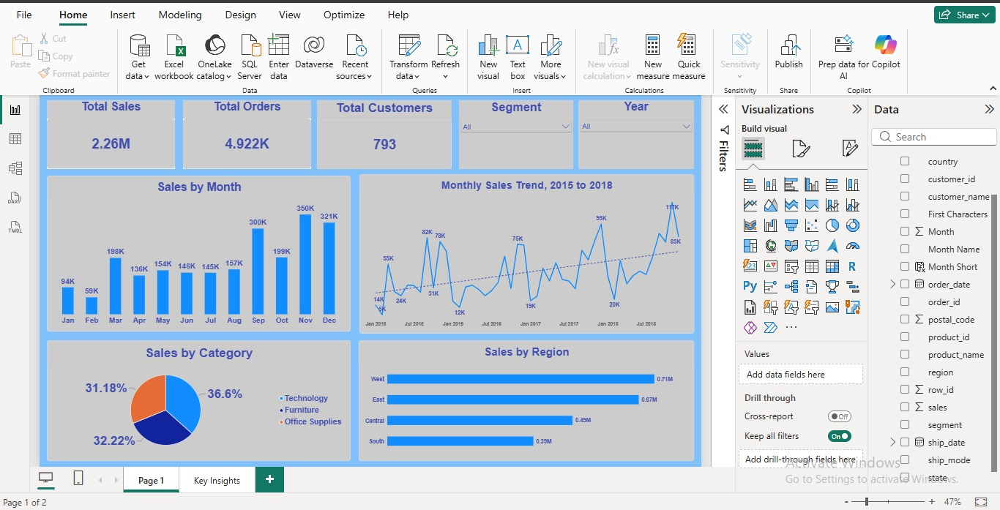
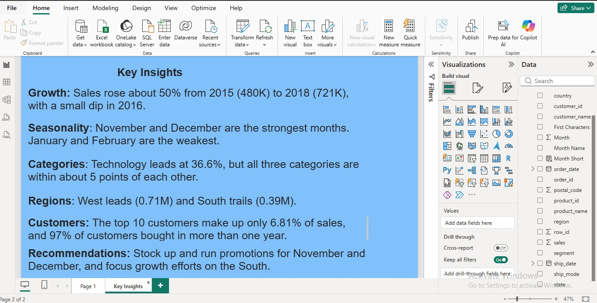

# Superstore Sales Analysis

An end-to-end data analysis project: cleaning retail sales data in Excel, querying it in MySQL, and presenting the results in a Power BI dashboard.

**Author:** Okedeji Ayoola, Economics student, Lagos State University

## Project overview

The goal was to turn raw order data from a retail business into clear answers a manager could act on: how sales are growing, when they peak, where they are strongest, and how loyal customers are.

- **Dataset:** Superstore sales data (Kaggle), 9,792 order lines from 2015 to 2018
- **Scope:** about 4,900 orders and 793 customers, with total sales of about $2.26M
- **Note:** the dataset has sales only (no profit column), so the analysis focuses on revenue and customer behaviour, not profitability

## Tools used

| Tool | Used for |
|---|---|
| Excel | Inspecting, cleaning and formatting the data |
| MySQL | Storing the data and answering business questions with SQL |
| Power BI | Building the interactive dashboard |

## Process

1. **Clean (Excel):** checked for blanks and duplicates, fixed date formats, and removed characters that caused import errors
2. **Load (MySQL):** designed the table, then loaded all 9,792 rows and checked the row count matched the source file
3. **Analyse (SQL):** answered 10 business questions (below)
4. **Visualise (Power BI):** built a two-page dashboard with KPI cards, slicers for year and segment, and a Key Insights page

## SQL skills demonstrated

- Aggregations: `SUM`, `COUNT(DISTINCT ...)`, `AVG`, `MIN`, `MAX`
- `GROUP BY` and `ORDER BY` on several columns
- Common table expressions (CTEs)
- Window functions: `RANK`, `DENSE_RANK`, `LAG` with `PARTITION BY`
- `CASE` expressions and `CROSS JOIN`

### Business questions answered

1. Date range of the data
2. Number of orders, customers and products, and total sales
3. Average sales value per order
4. Sales by category and sub-category
5. Sales by region and state
6. Strongest month in each year
7. Top 10 customers and their share of total sales
8. Year-on-year sales growth by category
9. Top 3 products in each region
10. Customers who ordered in one year only, some years, or every year

## Key findings

- **Growth:** sales rose about 50% from 2015 (about 480K) to 2018 (about 721K), with a small dip in 2016
- **Seasonality:** November and December are the strongest months, and January and February are the weakest
- **Regions:** the West leads (about 0.71M) and the South trails (about 0.39M)
- **Categories:** sales are fairly evenly split across the three categories (roughly 31% to 37% each)
- **Customers:** the top 10 customers account for only 6.81% of sales, so revenue does not depend on a few big buyers
- **Loyalty:** 97% of customers bought in more than one year, and 37% bought in all four years

## Recommendations

- Plan stock and promotions around November and December
- Focus growth efforts on the South region
- Protect customer loyalty, since repeat buyers drive most of the revenue

## Dashboard

## Files in this repository

- `Superstore_clean.pbix`: the Power BI dashboard
- `superstore_queries.sql`: all SQL queries
- `superstore_clean.csv`: the cleaned dataset
- `screenshots/`: dashboard images

## Limitations

- No profit data, so conclusions are about revenue only
- The data covers 2015 to 2018 only
- Findings describe patterns in the data and do not prove causes
